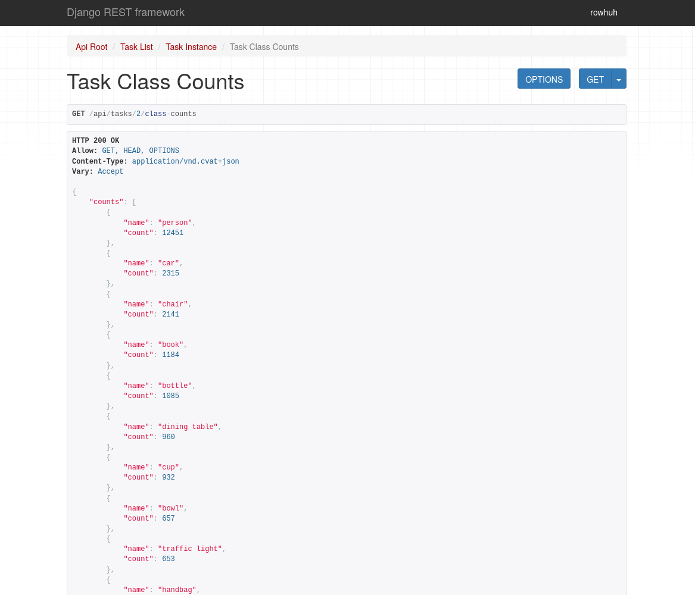
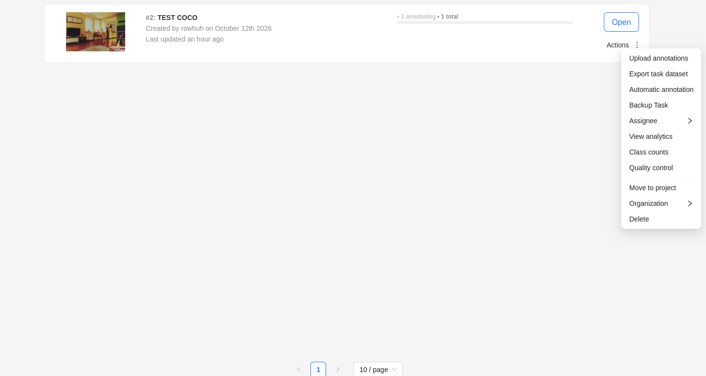
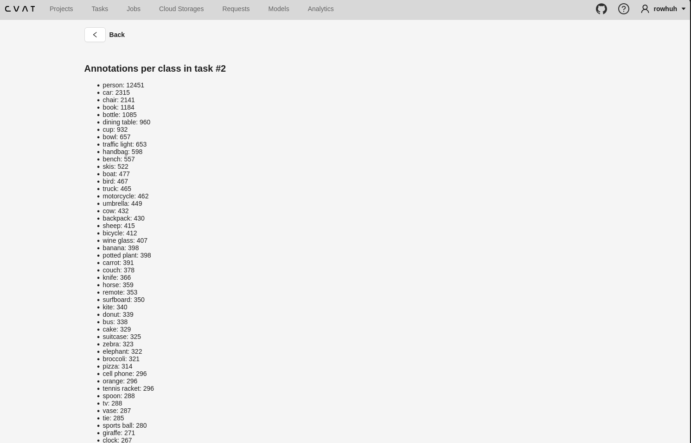
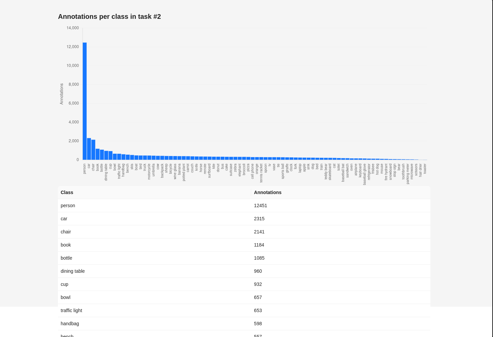
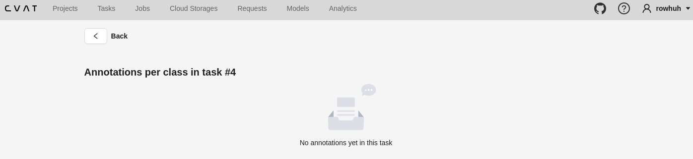
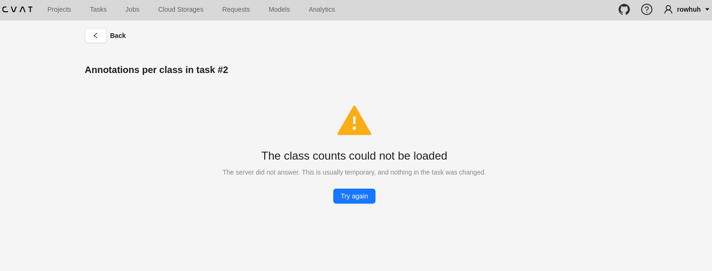
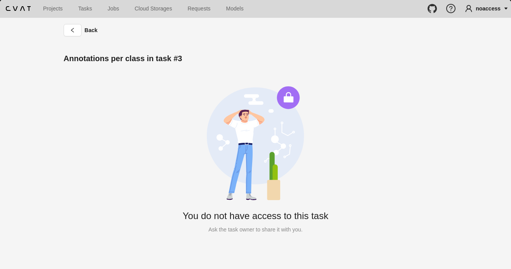

# Definition of Done

Written before any code. A line is only ticked when there is evidence beside it: a number, a
command with its output, a commit, or a screenshot. A tick with no evidence counts as not done.

## The floor (items 1 to 4)

- [x] The endpoint returns counts per class for a task.
  Evidence: calling `/api/tasks/<task id>/class-counts` returns every class with its count.

  

- [x] The counts are correct. I counted the same classes straight from the COCO annotation
  file for the images I uploaded, and the two sets of numbers match.

  **Evidence**:
  output of `validation-scripts/compare_counts.py`, run against task 2 with all
  5,000 images. All 80 classes match.

  <details>
  <summary>**Raw output (80 classes)**</summary>

  ```txt
  class               coco  endpoint
  person             12451     12451
  car                 2315      2315
  chair               2141      2141
  book                1184      1184
  bottle              1085      1085
  dining table         960       960
  cup                  932       932
  bowl                 657       657
  traffic light        653       653
  handbag              598       598
  bench                557       557
  skis                 522       522
  boat                 477       477
  bird                 467       467
  truck                465       465
  motorcycle           462       462
  umbrella             449       449
  cow                  432       432
  backpack             430       430
  sheep                415       415
  bicycle              412       412
  wine glass           407       407
  potted plant         398       398
  banana               398       398
  carrot               391       391
  couch                378       378
  knife                366       366
  horse                359       359
  remote               353       353
  surfboard            350       350
  kite                 340       340
  donut                339       339
  bus                  338       338
  cake                 329       329
  suitcase             325       325
  zebra                323       323
  elephant             322       322
  broccoli             321       321
  pizza                314       314
  cell phone           296       296
  orange               296       296
  tennis racket        296       296
  tv                   288       288
  spoon                288       288
  vase                 287       287
  tie                  285       285
  sports ball          280       280
  giraffe              271       271
  clock                267       267
  fork                 255       255
  laptop               248       248
  apple                243       243
  sink                 238       238
  dog                  237       237
  bed                  227       227
  train                224       224
  teddy bear           219       219
  skateboard           218       218
  cat                  211       211
  toilet               196       196
  baseball bat         185       185
  sandwich             180       180
  oven                 161       161
  airplane             160       160
  keyboard             158       158
  baseball glove       149       149
  refrigerator         134       134
  frisbee              129       129
  hot dog              128       128
  mouse                108       108
  fire hydrant         103       103
  snowboard             84        84
  stop sign             80        80
  bear                  73        73
  toothbrush            68        68
  parking meter         60        60
  microwave             56        56
  scissors              41        41
  hair drier            14        14
  toaster               10        10

  total: coco=41866 endpoint=41866
  MATCH
  ```

  </details>

  The totals are 41,866, not the 36,781 annotations in the COCO file. COCO counts objects, and
  CVAT stores each polygon piece of an object as its own shape. The script therefore expects one
  shape per polygon piece, plus one mask per crowd object, which is the same as the 41,420
  polygons and 446 masks in the database. The `coco` column shows that expected number.

- [x] The page opens from the task menu and calls the endpoint.
  **Evidence**:
  There is a new 'Class Count' actions in tasks - I actually figured this will be the best place to put it because I was able to find the other options there (such as quality control)'s code and I decided to just mimic the existing implementation.

  

  Clicking on class counts shows the following in a list - which i need to now convert into bar charts:

  

- [x] The counts are drawn as a chart. Initially, it was decided that i'll be using a bar chart with one bar per class. However, after trying that out, histograms are more visually appealign and look tighter
  **Evidence**:
  

- [x] A task with no annotations shows a clear "no annotations yet" message, not a blank chart.

  **Evidence:**
  To test this, I made a new task that wasn't annotated yet;
  

- [x] When the request fails, the page shows an error message and a way to retry. Tested by
  stopping the server.
  **Evidence:**
  I would refresh the page, then immediately run `docker stop cvat_server` and a try-again option along with a brief error message is being shown;




## Access (item 5)

- [x] A request with no login is refused.

    **Evidence:**
    If no user is logged in and I attempt to access the url, I'm redirected back to the login page.


- [x] A logged-in user with no access to the task is refused.

    **Evidence:**
    Created a new regular user and tried to manually access the class counts created by a super user;

    

  - [X] A user who can open the task gets the counts.

  **Evidence:**
   Heading to the url after logging in shows the actual class coutn
   !()[doc-assets/image9.png]

## Speed (item 6)

- [x] The target was written in `Objectives.md` before I measured anything.
  **Evidence:**
  Target was written in commit: `71dabc983561b4c0412a1d83880bb9b6b4a0e0c2`
  Validation was done in commit: `c72d76bd2849772cd0907dab7f92cc63238368c5`

- [x] Measured 5 times, raw output saved in `Objectives.md`.
  **Evidence:**
  Output has been pasted into objectives.md

- [x] Target met, or missed with the reason written down.
  **Evidence:**
  Target met . I estimated 150ms but got back ~50ms.
  Three reasons i believe the counting part is fast:
- **The database does the counting.** One query groups 41,866 rows and hands back 80. Python never loops over the annotations.
- **An index already exists.** CVAT's shape table has an index on the job, so the database jumps straight to this task's rows instead of scanning the whole table.
- **The answer is tiny.** 80 names and numbers, so there is almost nothing to send.

## Grouping (item 7)

- [ ] The page can show counts for a single job, and the numbers for all jobs add up to the
  task total.
  Evidence:

## Live updates (items 8 and 9)

- [ ] Adding or deleting an annotation in one browser tab changes the chart in another tab
  without a refresh.
  Evidence:
- [ ] After the server is restarted, the page reconnects by itself and shows the current counts.
  Evidence:

## Housekeeping

- [ ] The plan was the first commit, before any code.
  Evidence:
- [ ] Every commit message says what changed and why.
  Evidence:
- [ ] No leftover files, commented-out code or unused code in the pull request.
  Evidence:
- [ ] The pull request goes into my own fork, not the real CVAT repository.
  Evidence:
- [ ] Recording is 5 minutes or less and answers all four questions.
  Evidence:

## Not finished

Everything I did not reach is listed here, with the reason.

- Nothing yet.
