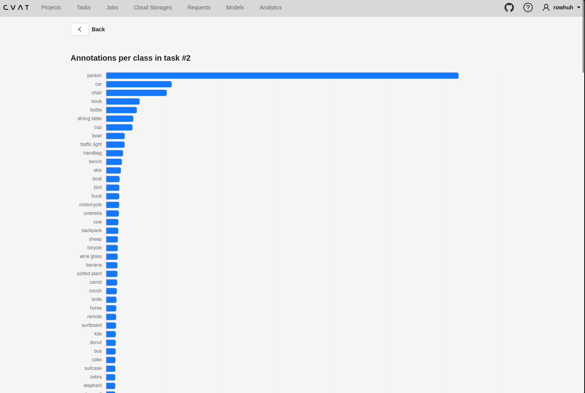

# Plan

Written before any code. Changes along the way are logged at the bottom, not edited in.

- Branch: `dev-test01`
- CVAT commit I started from: `454d60c31a59cb411d82660a3644e29d8fef7bb0`

## What I am building

A page in CVAT that shows, for one task, how many annotations each class has, as a bar chart.
The numbers come from a new API endpoint that counts them in the database.

## What I decided before starting

**What counts as one annotation.** One shape drawn on an image, with its class. That is what
the COCO set contains, so I can check my numbers against the COCO file one for one.

**Count in the database, not in Python or the browser.** The database can group and count rows
in a single query. The API returns the calculated data.

**Reuse CVAT's own login and access rules.** I will not write my own check for who can see a
task. CVAT already decides that for every task page. Using it also saves me time

**Keep my change contained.** Backend code goes in a new app, `cvat/apps/test`, which is also
the requirement. I only edit existing CVAT files where there is no other way to connect it. I'm not sure yet what the changes may be but I'll figure it out as I start with the implementation

## Order of work

| # | Step | Items | Time (hr:min) |
| --- | --- | --- | --- |
| 1 | Write and commit the three documents | | 0:30 |
| 2 | Small endpoint that returns counts per class for a task | 1 | 1:00 |
| 3 | Check the counts against the COCO file | 1 | 0:30 |
| 4 | Page that calls the endpoint and draws a bar chart | 2, 3 | 1:00 |
| 5 | Empty state and error state on the page | 4 | 0:30 |
| 6 | Refuse users who have no access to the task, and show both refusals | 5 | 0:30 |
| 7 | Measure the speed target, 5 runs | 6 | 0:45 |
| 8 | One grouping: counts for a single job | 7 | 0:45 |
| 9 | Live updates over WebSocket, and reconnecting | 8, 9 | 1:30 |
| 10 | Tick the Definition of Done, write the decision record, record the video | 10 | 1:00 |

Total: 8:00. Items 1 to 4 come first. I commit after each step.

CVAT refuses requests with no login by default, so step 2 gets that for free. Refusing a
logged-in user who cannot see the task is not free, so it is step 6. Until then, any logged-in
user can read any task's counts.

## How I will do each step

The files are my best guess. Anything else I touch is noted under "Changes to this plan".

**Step 1. Documents.** Write all three and commit them before any code.
Files: `docs/Plan.md`, `docs/Objectives.md`, `docs/Definition-of-Done.md`.

**Step 2. Endpoint.** Create the `test` app, shaped like a small existing CVAT app. It takes a
task number and returns each class name with its count.

**Step 3. Check it.** Count the same classes from the COCO file and compare.
Files: `docs/Definition-of-Done.md`. No code.

**Step 4. Page and chart.** CVAT's pages reach the server through a shared layer, `cvat-core`,
so I add my call there, then the page, its address and a task menu entry.
I don't really understand how the ui is working yet, but I'm guessing a new page goes under `cvat-ui/src/components/`. I'm certain more files will need to be changed but I won't name them yet because I'm not sure which ones so I'll be getting to those as I dive deeper in the code

**Step 5. Empty and error states.** Four states: loading, chart, "no annotations yet", and
"could not load" with retry. An empty task is a normal answer, not an error.
Files: the page folder.

**Step 6. Access.** Use the check CVAT already has for "can this user see this task". Call the
endpoint as nobody, as a user with no access, and as the owner, and keep the output.
New: `cvat/apps/test/permissions.py`. Edited: `cvat/apps/test/views.py`.

**Step 7. Speed.** Time the endpoint 5 times and record the raw output, median and spread.
Files: `docs/Objectives.md`.

**Step 8. Grouping.** The endpoint accepts an optional job number. The page gets a job picker.
Files: `cvat/apps/test/views.py`, `cvat-core/src/server-proxy.ts`, the page folder.

**Step 9. Live updates.** The page keeps one connection open. When annotations change, the
server sends "something changed" and the page fetches the counts again. If the connection
drops, the page retries and fetches once on return.
New: two or three files in `cvat/apps/test/`.
Edited: `cvat/asgi.py`, `cvat/settings/base.py`, `cvat/requirements/base.in`, the page folder.

**Step 10. Finish.** Tick the checklist with evidence, list what I did not reach, write the
decision record, record the video.
Files: the three documents.

## The grouping I chose, and why

Counts for a single job. A task is split into jobs, each given to one person. The task total
shows what you have; the per-job count shows where a class is missing and who to ask.

## Where I will stop

Step 9 is the one I am least sure about, because CVAT has no WebSocket support today. If it is
not working after 1 hour 30 minutes, I stop, remove the unfinished code, and write down how far
I got.

## What I am skipping on purpose

- Video tasks and whole-image tags. COCO has neither, so I cannot check them. A video task
  would show too few annotations on my page.
- Counts for a whole project. The task says per task.
- Automated browser tests. I test the page by hand and record what I checked.
- Speeding up the endpoint before measuring it.

## Changes to this plan

1. When doing the second requirement (A page in the web interface that calls it.) which is part of step 3 and 4 in this doc, I figured I don't need to touch cvat-core. I just found the code implementing other pages under tasks > actions and placed one more page there that will show annotations. This, was I figured a minimal way to go through this and touching cvat-core which I don't understand yet was overkill for this so yeah.

2. I initially planned on using the bar chart but since coco has a lot of classes, it was appearing too long like stretched out vertically so I switched to histograms because they're horizontally stretched and can be fit into one view.
   This is with bar chart:

   

   It isn't fitting so yeah switched to a histogram

3. In step 6, i initially planned on adding a permissions.py to cvat/app/test when writing the plan for the first time because I noticed a few apps do that so I figured that perhaps i should do the same. However the goal was achieved by only tweaking the `cvat/apps/test/views.py` file so I didn't go through with it. It also saved me some time.

4. For step 8 I built the grouping I planned, counts for a single job. I wanted to explore this item more, so I added one more: a switch that counts images instead of annotations. For each class it shows how many images contain it. The plain count says "person: 12,451" but not whether those are spread over many images or packed into a few. In task 2 they are in 2,693 images. I checked the image numbers against the COCO file the same way as the first count, and all 80 classes match.
   This was not in the plan, and it changed three files: `cvat/apps/test/views.py`, the page, and `validation-scripts/compare_counts.py`. It also makes the database query slower, so the speed result in `Objectives.md` has to be measured again.
   Step 8 also listed `cvat-core/src/server-proxy.ts`. I did not touch it, for the same reason as change 1.

5. I stopped after step 8. I ran out of time, so step 9 (live updates over WebSocket and reconnecting) was not started, and the decision record in step 10 was not written. There was no unfinished code to remove. The full list is under "Not finished" in `Definition-of-Done.md`.

## Decision record

Not written. I did not reach item 10, see change 5 above.
