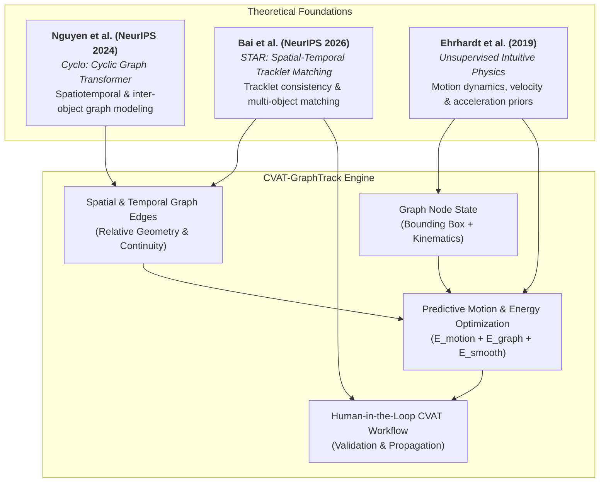
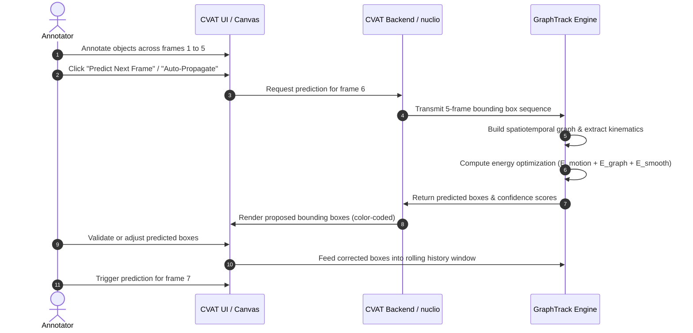

# CVAT-GraphTrack Improvement Plan

## Proposed Fork Title

**`cvat-graphtrack`**

### Full Project Title

**CVAT-GraphTrack: Graph-Based Predictive Video Object Annotation**

### Short Description

> A CVAT extension for semi-automatic video object tracking that predicts future object positions from the first annotated frames using spatiotemporal graph modeling and motion estimation.

---

## Theoretical Foundations & Literature Attribution

The architecture, graph modeling principles, and predictive motion formulation of **CVAT-GraphTrack** are grounded in recent advances in spatiotemporal graph neural representations, tracklet matching, and unsupervised physical motion modeling from three key research works:



### 1. Spatiotemporal & Inter-Object Graph Representation: Cyclo (Nguyen et al., NeurIPS 2024)
- **Paper**: *Cyclo: Cyclic graph transformer approach to multi-object relationship modeling in aerial videos* (NeurIPS 2024).
- **Inspiration**: Real-world object motion is rarely isolated; moving objects (such as vehicles in traffic lanes, pedestrians walking in groups, or aerial drone targets) influence and correlate with each other. Cyclo demonstrates how cyclic graph topologies and relational attention capture complex inter-object spatial distributions and temporal transitions over consecutive frames. In `cvat-graphtrack`, this underpins the **spatial-temporal graph structure** (Section 5) and the **graph relationship consistency energy** (Section 6), which preserves pairwise distance vectors and directional alignment among neighboring objects across time.

### 2. Spatial-Temporal Tracklet Matching & Identity Continuity: STAR (Bai et al., NeurIPS 2026)
- **Paper**: *STAR: Spatial-Temporal Tracklet Matching for Multi-Object Tracking* (NeurIPS 2026).
- **Inspiration**: Tracking accuracy in video annotation relies heavily on tracklet association over short sliding temporal windows. STAR establishes spatial-temporal matching criteria across tracklet representations to maintain robust identity persistence, mitigate occlusion-induced trajectory breaks, and prevent track drifts. In `cvat-graphtrack`, STAR's principles motivate our **temporal edge formulation** (Section 5.2), **confidence estimation under occlusion/instability** (Section 9), and **identity consistency evaluation metrics** (Section 11).

### 3. Motion Dynamics and Physical Priors: Ehrhardt et al. (2019)
- **Paper**: *Unsupervised intuitive physics from past experiences* (arXiv:1905.10793, 2019).
- **Inspiration**: Ehrhardt et al. demonstrate that rich physical behavior (momentum, velocity, acceleration, friction, collision avoidance) can be learned and predicted from short past observational sequences without explicit heavy manual supervision. In `cvat-graphtrack`, this directly inspires the **kinematic feature extraction pipeline** (velocity and acceleration vectors derived across the initial 5 annotated frames) and the **physics-inspired energy minimization constraints** (Section 4 & Section 6.3) enforcing smooth trajectory dynamics.

---

# 1. Formulated Idea

The goal of this project is to enhance CVAT with a **predictive video annotation assistant** for object tracking.

In standard video annotation, a user manually annotates objects frame by frame or uses interpolation between keyframes. This project introduces a method where the user annotates the same objects in the first **5 consecutive frames**, and the system learns the short-term motion pattern of each object.

Then, for the next frames, the system predicts the future position of each object automatically.

The main idea is to represent objects across frames as a **spatiotemporal graph**:

- Each object in a frame is represented as a **node**.
- Spatial relationships between objects in the same frame are represented as **intra-frame edges**.
- Temporal relationships of the same object across consecutive frames are represented as **inter-frame edges**.
- Edge weights encode distance, motion similarity, direction consistency, and relative object movement.

Using the motion observed during the first 5 frames, the system predicts the next position of each object while preserving realistic spatial relationships between objects.

The prediction is not intended to replace the annotator. Instead, it acts as a **human-in-the-loop assistant**: CVAT proposes the next bounding boxes, and the user validates or corrects them.

---

# 2. Problem Statement

Video object annotation is time-consuming because annotators often need to adjust bounding boxes across many frames. Existing interpolation methods can help, but they may struggle when objects move non-linearly, change speed, interact with other objects, or become temporarily occluded.

This project aims to answer the following question:

> Can we use the movement history of annotated objects over a short sequence of frames to predict their future positions and reduce manual video annotation effort?

The proposed solution is a **graph-based motion prediction module** integrated into CVAT.

---

# 3. Main Objective

Develop a CVAT extension that:

1. Takes manually annotated object bounding boxes from the first 5 frames.
2. Builds a spatiotemporal graph of object positions and relationships.
3. Estimates each object’s motion pattern.
4. Predicts object locations in the next frame or next few frames.
5. Displays the predicted annotations in CVAT for user validation.
6. Updates the prediction model when the user corrects the boxes.

---

# 4. Proposed Methodology

## Step 1: Input Definition

Assume the user annotates objects in frames:

$$F_1, F_2, F_3, F_4, F_5$$

For each object $i$, CVAT provides a bounding box:

$$B_i^t = (x_i^t, y_i^t, w_i^t, h_i^t)$$

where:

- $x_i^t, y_i^t$: bounding box center or top-left coordinates
- $w_i^t$: width
- $h_i^t$: height
- $i$: object ID
- $t$: frame index

It is better to use the center point:

$$C_i^t = (x_i^t, y_i^t)$$

where:

$$x_i^t = x_{\text{left}}^t + \frac{w_i^t}{2}$$

$$y_i^t = y_{\text{top}}^t + \frac{h_i^t}{2}$$

The system will track the movement of each center point across the 5 frames.

---

## Step 2: Motion Feature Extraction

For each object, compute displacement between consecutive frames:

$$\Delta C_i^t = C_i^t - C_i^{t-1}$$

This gives the object’s movement vector.

Then estimate velocity:

$$V_i^t = \frac{C_i^t - C_i^{t-1}}{\Delta t}$$

If frames are consecutive, then $\Delta t = 1$, so:

$$V_i^t = C_i^t - C_i^{t-1}$$

From the first 5 frames, you get 4 velocity vectors:

$$V_i^2, V_i^3, V_i^4, V_i^5$$

You can also estimate acceleration (drawing from intuitive physics formulation):

$$A_i^t = V_i^t - V_i^{t-1}$$

This helps model speed changes and direction changes.

For each object, store:

```text
object_id
frame_id
bbox
center_x
center_y
width
height
velocity_x
velocity_y
acceleration_x
acceleration_y
confidence
```

---

## Step 3: Baseline Prediction Model

Before implementing a complex graph neural network, start with a simple and explainable motion model.

### Option A: Constant Velocity Prediction

The simplest prediction for frame 6 is:

$$\hat{C}_i^6 = C_i^5 + \bar{V}_i$$

where:

$$\bar{V}_i = \frac{1}{4}\sum_{t=2}^{5} V_i^t$$

This means the next position is the last known position plus the average movement.

### Option B: Weighted Velocity Prediction

Recent movement is usually more informative than older movement.

$$\bar{V}_i = \alpha_1 V_i^5 + \alpha_2 V_i^4 + \alpha_3 V_i^3 + \alpha_4 V_i^2$$

with:

$$\alpha_1 > \alpha_2 > \alpha_3 > \alpha_4$$

Example:

```python
alpha_1 = 0.4
alpha_2 = 0.3
alpha_3 = 0.2
alpha_4 = 0.1
```

Then:

$$\hat{C}_i^6 = C_i^5 + \bar{V}_i$$

### Option C: Acceleration-Aware Prediction

If the object is speeding up or slowing down:

$$\hat{C}_i^6 = C_i^5 + \bar{V}_i + \frac{1}{2}\bar{A}_i$$

This is useful when the object motion is not constant.

---

# 5. Graph-Based Modeling

The core contribution of your fork is the graph-based representation (informed by **Cyclo** and **STAR**).

You can define a graph:

$$G = (V, E)$$

where:

- $V$: nodes representing annotated objects
- $E$: edges representing spatial or temporal relationships

```text
       Frame t-1                    Frame t                    Frame t+1 (Predicted)
   ┌───────────────┐           ┌───────────────┐           ┌───────────────────┐
   │  Node v_1^(t-1)│ ──(temp)─>│   Node v_1^t  │ ──(temp)─>│   Node v_1^(t+1)   │
   └───────┬───────┘           └───────┬───────┘           └─────────┬─────────┘
           │                           │                             │
        (spatial)                   (spatial)                     (spatial)
           │                           │                             │
   ┌───────┴───────┐           ┌───────┴───────┐           ┌─────────┴─────────┐
   │  Node v_2^(t-1)│ ──(temp)─>│   Node v_2^t  │ ──(temp)─>│   Node v_2^(t+1)   │
   └───────────────┘           └───────────────┘           └───────────────────┘
```

---

## 5.1 Node Representation

Each node corresponds to one object in one frame:

$$v_i^t$$

Each node contains features:

$$X_i^t = [x_i^t, y_i^t, w_i^t, h_i^t, V_{x,i}^t, V_{y,i}^t, A_{x,i}^t, A_{y,i}^t]$$

So a node is not only a point, but a motion-aware object state.

---

## 5.2 Temporal Edges

Temporal edges connect the same object across consecutive frames:

$$(v_i^{t-1}, v_i^t)$$

These edges describe the trajectory of object $i$.

Example:

```text
car_1_frame_1 -> car_1_frame_2 -> car_1_frame_3 -> car_1_frame_4 -> car_1_frame_5
```

Temporal edges help estimate:

- direction
- speed
- acceleration
- smoothness of motion

---

## 5.3 Spatial Edges

Spatial edges connect different objects in the same frame:

$$(v_i^t, v_j^t)$$

For example, if two cars are moving in the same direction, their relative distance may remain approximately stable.

The spatial distance is:

$$d_{ij}^t = ||C_i^t - C_j^t||$$

You can create an edge only if:

$$d_{ij}^t < \tau$$

where $\tau$ is a distance threshold.

Alternatively, connect each object to its $k$-nearest neighbors.

---

## 5.4 Edge Weights

A spatial edge weight can be defined as:

$$w_{ij}^t = \exp \left(-\frac{d_{ij}^t}{\sigma}\right)$$

where:

- close objects have stronger relationships
- distant objects have weaker relationships

You can also include motion similarity:

$$s_{ij}^t = \frac{V_i^t \cdot V_j^t}{||V_i^t|| ||V_j^t||}$$

This is cosine similarity between movement directions.

Then:

$$w_{ij}^t = \exp \left(-\frac{d_{ij}^t}{\sigma}\right) \cdot \max(0, s_{ij}^t)$$

This means two objects are strongly connected if they are close and moving in a similar direction.

---

# 6. Graph-Based Prediction Strategy

The prediction combines two sources of information:

1. The object’s own motion history.
2. The relationship between this object and nearby objects.

---

## 6.1 Initial Prediction

First, compute an initial prediction using velocity and acceleration:

$$\hat{C}_{i,\text{motion}}^{t+1}$$

This gives a first estimate for each object.

---

## 6.2 Relationship Correction

Then refine the prediction using graph relationships.

For two objects $i$ and $j$, their previous relative position is:

$$R_{ij}^t = C_i^t - C_j^t$$

If their relationship is stable, then the predicted relative position should be similar:

$$\hat{C}_i^{t+1} - \hat{C}_j^{t+1} \approx R_{ij}^t$$

This is useful for objects moving together, such as:

- cars in the same lane
- people walking in a group
- animals moving together
- sports players maintaining formation

---

## 6.3 Optimization Formulation

You can refine all predicted positions by minimizing an energy function:

$$E = E_{\text{motion}} + \lambda E_{\text{graph}} + \gamma E_{\text{smooth}}$$

where:

### Motion Consistency

$$E_{\text{motion}} = \sum_i ||\hat{C}_i^{t+1} - \hat{C}_{i,\text{motion}}^{t+1}||^2$$

This keeps the final prediction close to the motion-based estimate.

### Graph Relationship Consistency

$$E_{\text{graph}} = \sum_{(i,j)} w_{ij} ||(\hat{C}_i^{t+1} - \hat{C}_j^{t+1}) - R_{ij}^t||^2$$

This preserves spatial relationships between related objects.

### Smoothness Constraint

$$E_{\text{smooth}} = \sum_i ||\hat{C}_i^{t+1} - 2C_i^t + C_i^{t-1}||^2$$

This discourages unrealistic sudden jumps (inspired by intuitive physics priors).

The final prediction is:

$$\hat{C}^{t+1} = \arg\min E$$

In the first version, you can implement this using simple numerical optimization with NumPy or SciPy.

---

# 7. Bounding Box Prediction

Predicting the center point is not enough. You also need to predict the bounding box size.

For width:

$$\hat{w}_i^{t+1} = w_i^t + \bar{\Delta w}_i$$

For height:

$$\hat{h}_i^{t+1} = h_i^t + \bar{\Delta h}_i$$

where:

$$\bar{\Delta w}_i = \frac{1}{4}\sum_{t=2}^{5}(w_i^t - w_i^{t-1})$$

$$\bar{\Delta h}_i = \frac{1}{4}\sum_{t=2}^{5}(h_i^t - h_i^{t-1})$$

Then reconstruct the predicted bounding box:

$$\hat{B}_i^{t+1} = (\hat{x}_i^{t+1}, \hat{y}_i^{t+1}, \hat{w}_i^{t+1}, \hat{h}_i^{t+1})$$

where:

$$\hat{x}_{\text{left}, i}^{t+1} = \hat{C}_{x, i}^{t+1} - \frac{\hat{w}_i^{t+1}}{2}$$

$$\hat{y}_{\text{top}, i}^{t+1} = \hat{C}_{y, i}^{t+1} - \frac{\hat{h}_i^{t+1}}{2}$$

You should also apply constraints:

```text
width > 0
height > 0
bbox must stay inside image boundaries
box size should not change unrealistically fast
```

---

# 8. Human-in-the-Loop Annotation Workflow

The system works as an assistant inside CVAT.



Recommended workflow:

1. User selects video.
2. User annotates objects in frames 1 to 5.
3. User clicks **"Predict Next Frame"** or **"Auto-Propagate"**.
4. System builds spatiotemporal graph.
5. System predicts object boxes for frame 6.
6. CVAT displays predicted boxes.
7. User accepts or corrects them.
8. Corrected boxes are added to the history.
9. System predicts frame 7.
10. Process continues.

This is important because prediction errors will accumulate over time. User correction keeps the system reliable.

---

# 9. Confidence Estimation

Each predicted box should have a confidence score.

Confidence depends on:

1. **Motion stability**: Low variance across past displacement vectors.
2. **Acceleration magnitude**: Penalizes abrupt acceleration jerks.
3. **Object occlusion & overlap**: Tracklet consistency checks (informed by STAR).
4. **Distance from image boundary**: Margin checks preventing boundary clipping.
5. **Consistency with neighboring objects**: High relational agreement in the spatial graph.

Example:

$$conf_i = \exp(-\text{motion\_variance}_i)$$

where motion variance measures how unstable the object movement was during the first 5 frames.

If confidence is low, CVAT should highlight the box as requiring user review.

Example categories:

| Confidence Level | Score Range | UI Display Color | Recommended User Action |
| :--- | :--- | :--- | :--- |
| **High confidence** | $\ge 0.80$ | 🟢 Green | Quick visual confirmation |
| **Medium confidence** | $0.50 \le \text{score} < 0.80$ | 🟡 Yellow | Inspect edges / minor boundary adjustment |
| **Low confidence** | $< 0.50$ | 🔴 Red | Mandatory manual review / re-annotation |

---

# 10. Implementation Plan for CVAT

You can develop this in stages.

## Phase 1: Standalone Python Prototype

Before modifying CVAT deeply, create a small Python module.

Input:

```json
{
  "frames": [1, 2, 3, 4, 5],
  "objects": [
    {
      "id": 1,
      "boxes": [
        [100, 120, 50, 80],
        [106, 121, 50, 80],
        [113, 123, 51, 81],
        [120, 124, 51, 81],
        [128, 126, 52, 82]
      ]
    }
  ]
}
```

Output:

```json
{
  "frame": 6,
  "predictions": [
    {
      "id": 1,
      "bbox": [136, 128, 52, 82],
      "confidence": 0.91
    }
  ]
}
```

Suggested prototype structure:

```text
cvat-graphtrack/
│
├── graphtrack/
│   ├── __init__.py
│   ├── motion.py        # Velocity, acceleration, baseline extrapolation
│   ├── graph.py         # Spatial and temporal graph construction
│   ├── predictor.py     # Energy-based prediction and refinement
│   ├── confidence.py    # Uncertainty and stability scoring
│   └── utils.py         # Geometry helpers and coordinate conversions
│
├── examples/
│   └── demo_prediction.py
│
├── tests/
│   └── test_predictor.py
│
└── README.md
```

---

## Phase 2: Add Graph-Based Refinement

Implement:

```text
motion.py       -> velocity and acceleration estimation
graph.py        -> spatial and temporal graph construction
predictor.py    -> prediction and refinement
confidence.py   -> uncertainty scoring
```

Useful libraries:

```text
numpy
scipy
networkx
opencv-python
```

Start with `networkx` for graph construction. Later, if you want deep learning, you can explore PyTorch Geometric.

---

## Phase 3: CVAT Integration

There are two possible integration strategies.

### Option A: Serverless AI Function (Recommended for MVP)

CVAT supports AI-assisted annotation through Nuclio serverless functions (located under `serverless/`). You can expose your predictor as an AI function.

General flow:

```text
CVAT UI -> AI function request -> GraphTrack predictor -> predicted boxes -> CVAT UI
```

This is the cleanest option to keep your implementation modular without risking breaks in core CVAT code.

### Option B: Direct CVAT Extension

You can integrate the feature directly into the CVAT frontend and backend:
- **CVAT UI (`cvat-ui/`)**: Add dedicated buttons and controls in the object track toolbar.
- **CVAT Core (`cvat-core/`) & CVAT Backend (`cvat/apps/engine/`)**: Implement track prediction handlers that read keyframes directly from job annotation records.

Possible UI action:

```text
Button: "Predict Next Frame"
Button: "Auto-Propagate 5 Frames"
Button: "GraphTrack Settings"
```

Settings could include:

```text
number of history frames = 5
prediction horizon = 1
use graph refinement = true
confidence threshold = 0.7
```

For a first contribution, the serverless/modular approach is usually easier to maintain and demonstrate.

---

# 11. Evaluation Methodology

You should evaluate whether your method actually reduces annotation effort.

## Datasets

Test on public video tracking datasets providing ground-truth object trajectories:

- **MOT17 / MOT20**: Pedestrian tracking in dense crowds (tests group spatial coherence and occlusion handling).
- **DanceTrack**: Articulated and non-linear trajectories with identical appearance (tests graph motion models).
- **KITTI Tracking**: Moving vehicles and autonomous driving scenes.
- **BDD100K Tracking subset**: Complex urban scenes with diverse road participants.

---

## Metrics

### 1. Prediction Error

Measure center error:

$$E_{\text{center}} = ||\hat{C}_i^t - C_i^t||$$

Lower is better.

---

### 2. Bounding Box IoU

$$IoU = \frac{\text{Area}(\hat{B} \cap B)}{\text{Area}(\hat{B} \cup B)}$$

Higher is better.

---

### 3. Number of Manual Corrections

Compare:

```text
manual annotation without prediction
manual annotation with linear interpolation
manual annotation with GraphTrack
```

The key practical metric is:

> How many user corrections are avoided?

---

### 4. Annotation Time Reduction

Measure time spent per video:

```text
time without GraphTrack
time with GraphTrack
```

Then compute:

$$\text{Reduction} = \frac{T_{\text{manual}} - T_{\text{GraphTrack}}}{T_{\text{manual}}} \times 100$$

---

### 5. Tracking Identity Consistency

For multi-object videos, evaluate whether the system preserves object identities correctly.

Useful metrics:

- **ID switches (IDSW)**
- **MOTA** (Multi-Object Tracking Accuracy)
- **IDF1** (Identification F1 Score)
- **HOTA** (Higher Order Tracking Accuracy)

---

# 12. Recommended Initial Version

For the first implementation, avoid making the system too complex.

## MVP Title

**GraphTrack MVP: Short-Term Object Motion Prediction from Five Annotated Frames**

## MVP Features

```text
1. Accept 5 annotated frames.
2. Compute velocity and acceleration.
3. Predict next frame bounding boxes.
4. Build spatial graph between objects.
5. Refine predictions using graph relationship consistency.
6. Return confidence scores.
7. Allow user correction and update history.
```

## MVP Algorithm

```text
Input: bounding boxes from frames 1–5

For each object:
    compute center points
    compute velocities
    compute acceleration
    estimate next center
    estimate next width and height

Build graph:
    nodes = objects
    temporal edges = same object across frames
    spatial edges = nearby objects in same frame

Refine predictions:
    preserve motion consistency
    preserve stable neighbor relationships
    avoid sudden jumps

Output:
    predicted bounding boxes for frame 6
    confidence score for each object
```

---

# 13. Possible README Formulation

You can describe your fork like this:

> **CVAT-GraphTrack** is an experimental extension of CVAT for semi-automatic video object annotation. The tool allows users to annotate objects in the first five frames and then predicts their positions in subsequent frames using motion estimation and spatiotemporal graph modeling. Each object is represented as a graph node, while spatial and temporal edges capture inter-object relationships and motion continuity. The system provides predicted bounding boxes with confidence scores, allowing annotators to validate or correct the results in a human-in-the-loop workflow.

---

# 14. Suggested Contribution Title for CVAT Issue or Pull Request

If you later open an issue or discussion in the official CVAT repository, use a title like:

**Feature Proposal: Graph-Based Predictive Tracking for Video Annotation**

or:

**Add Short-Term Graph-Based Motion Prediction from Initial Keyframe Annotations**

---

# 15. Important Technical Note

Using only 5 frames is suitable for **short-term prediction**, but long-term prediction will become uncertain, especially with:

- occlusion
- sudden direction changes
- camera movement
- object interaction
- fast motion
- motion blur

Therefore, your system should predict only a small number of future frames at a time and ask the user to validate the results.

A strong first target is:

```text
Annotate 5 frames -> predict 1 frame -> user validates -> continue
```

Then later:

```text
Annotate 5 frames -> predict 5 frames -> user validates
```

This makes the method safer and more useful for real annotation workflows.

---

# References and BibTeX Citations

The conceptual framework and algorithmic design of `cvat-graphtrack` are directly informed by the following publications:

```bibtex
@article{nguyen2024cyclo,
  title={Cyclo: Cyclic graph transformer approach to multi-object relationship modeling in aerial videos},
  author={Nguyen, Trong-Thuan and Nguyen, Pha and Li, Xin and Cothren, Jackson and Yilmaz, Alper and Luu, Khoa},
  journal={Advances in Neural Information Processing Systems},
  volume={37},
  pages={90355--90383},
  year={2024}
}

@article{bai2026star,
  title={STAR: Spatial-Temporal Tracklet Matching for Multi-Object Tracking},
  author={Bai, Xuewei and Wang, Yongcai and Li, Deying and Ping, Haodi and Chunxu, LI},
  journal={Advances in Neural Information Processing Systems},
  volume={38},
  pages={68334--68357},
  year={2026}
}

@article{ehrhardt2019unsupervised,
  title={Unsupervised intuitive physics from past experiences},
  author={Ehrhardt, S{\'e}bastien and Monszpart, Aron and Mitra, Niloy J and Vedaldi, Andrea},
  journal={arXiv preprint arXiv:1905.10793},
  year={2019}
}
```
