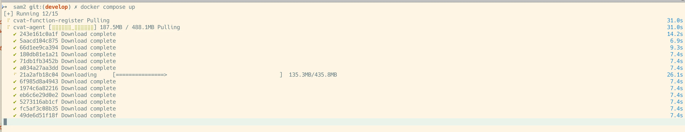
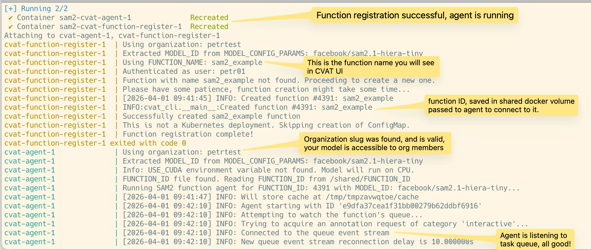
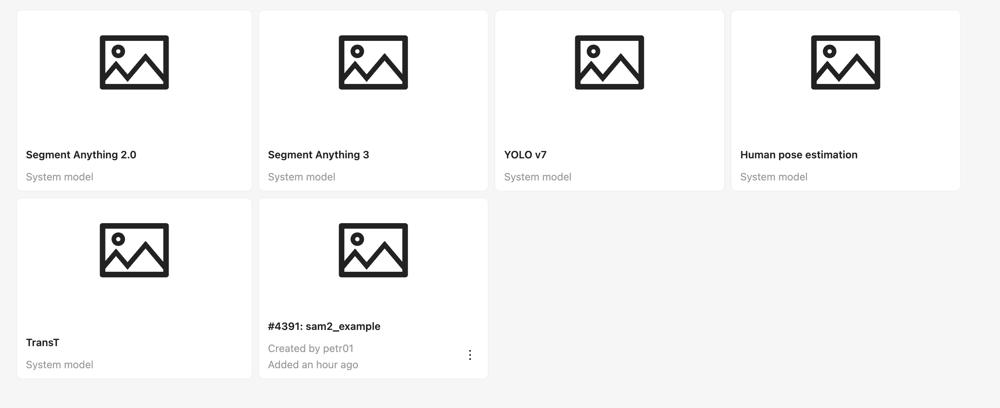
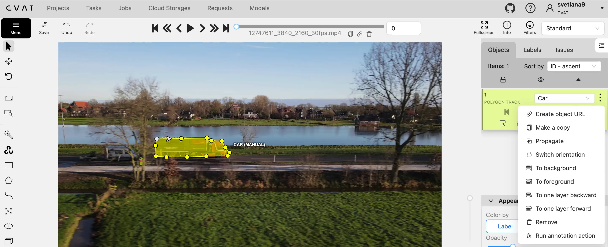
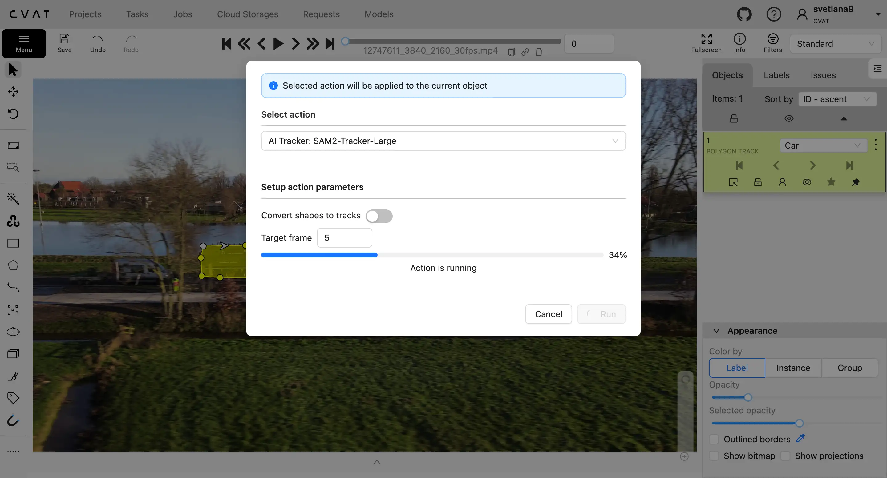
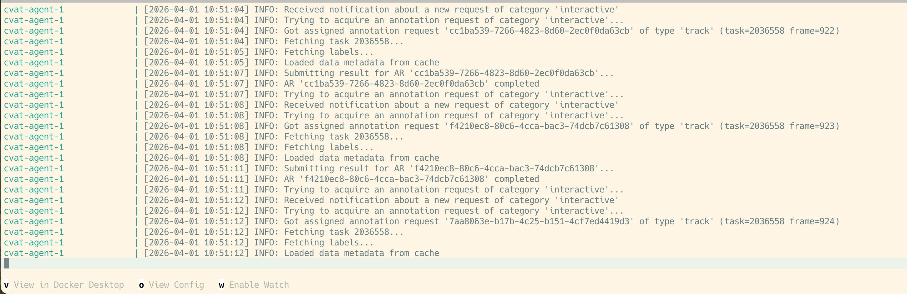
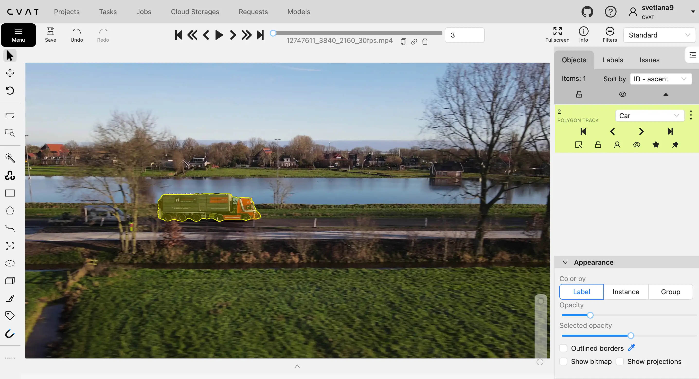
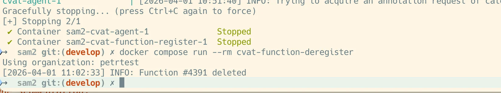

## Introduction

Since CVAT agents were announced, we have been working on making it easier for users to deploy their agents in CVAT
and we are excited to share with you new ways to do that. In this guide we will cover how to deploy your agent to CVAT
using Docker Compose.
This approach is not the only way to deploy your agent (see [Helm deployment guide](/docs/guides/helm-agents-userguide/)),
but it is a great option for those, who are not familiar with Kubernetes and want to quickly get
started with deploying their agents in CVAT.

In this guide we will cover the following topics:

- High-level overview of the Docker Compose approach for deploying CVAT agents
- How to prepare your machine for running CVAT agents with Docker Compose
- How to configure Docker Compose to run your CVAT agent
- How to run CVAT agent with Docker Compose
- How to clean up after running CVAT agent with Docker Compose
- Troubleshooting common issues with Docker Compose deployment

## High-level overview of the Docker Compose approach for deploying CVAT agents

In general the Docker Compose workflow consists of the following steps:

1. Register your model as a function in CVAT using [`cvat-cli`](/docs/api_sdk/cli/_index.md)
2. Run your agent that will be polling CVAT for new tasks and processing them with your model.
3. When agent is not needed anymore, deregister function in CVAT to clean up.


## How to prepare your machine for running CVAT agents with Docker Compose

To run CVAT agents with Docker Compose, you need to have the following software installed on your machine:

- [Docker](https://docs.docker.com/engine/install/)
- [Docker Compose](https://docs.docker.com/compose/install/)

Please refer to the official documentation for instructions on how to install Docker and Docker Compose on your machine.

Also, it has to be mentioned that your machine should have network access to the CVAT instance
where you want to deploy your agent, and you should have an API key for authentication in [CVAT](https://app.cvat.ai/profile#security).

## How to configure Docker Compose to run your CVAT agent

Clone the standalone [`cvat-models`](https://github.com/cvat-ai/cvat-models) repository to get the
agent Dockerfiles, Compose files, and environment templates:

```bash
git clone https://github.com/cvat-ai/cvat-models.git
cd cvat-models
```

Choose an agent bundle:

| Model | Agent directory |
| ----- | --------------- |
| YOLO | `detector/yolo/agent` |
| RF-DETR | `detector/detr/agent` |
| Hugging Face Transformers | `detector/transformers/agent` |
| SAM2 tracker | `tracker/sam2/agent` |
| RT-DETRv2-OBB | `detector/rtdetrv2_obb/agent` |

Each directory contains the files needed to build an image or run an available pre-built image.
Check its `.env` comments and model README for image availability and model-specific parameters.

To build an image, run the build from the `cvat-models` repository root because the Dockerfiles use
that directory as their build context. Set `<agent-directory>` to a path from the table and use a
CVAT SDK/CLI version compatible with your CVAT instance:

```bash
docker build --build-arg CVAT_VERSION=<CVAT_VERSION> --build-arg USE_GPU=false \
  --file <agent-directory>/Dockerfile --tag <image-name>:latest .
```

For a CUDA-capable image, set `USE_GPU=true` and use a different tag. Then set `IMAGE_URL` in the
agent's `.env` file to the image you built and change to that agent directory before running
Compose:

```bash
cd <agent-directory>
```


### Environment configuration

To configure Docker Compose you need to provide the following information in the `.env` file:

CVAT_BASE_URL - URL of the CVAT instance where you want to deploy your agent. Defaults to <https://app.cvat.ai>

CVAT_ACCESS_TOKEN - Access token to use with cvat-cli to connect to CVAT instance. You can get it in CVAT UI: <https://app.cvat.ai/profile#security>

FUNCTION_NAME - Name of the function to register in CVAT. For example it could be SAM2 or MY_GREAT_MODEL.

IMAGE_URL - URL of the image to use for your agent. You can either build your own image or just
use an available image from our repository: <https://hub.docker.com/r/cvat/>. Check the selected
agent's `.env` file to determine whether a pre-built image is available.

AGENTS_COUNT - Number of agent replicas to run. Depends on the model.

ORG_SLUG - Your org slug. This is important if you want to share your function across the organization.

COMPOSE_PROFILES - whether to use cpu or gpu to run your agent. To use GPU, set this to "gpu".
Requires Linux + NVIDIA GPU + NVIDIA driver + NVIDIA Container Toolkit + GPU docker image

FUNCTION_VISIBILITY - `private` limits the function to you and, when `ORG_SLUG` is set, members of
that organization. `public` makes it available to every user of the CVAT instance.

MODEL_CONFIG_PARAMS - Parameters to pass to the adapter function. Differs for each model.
Refer to the selected model documentation and the comments in its `.env` file. For example, see
`detector/transformers/agent/.env` for Transformers parameters.

## How to run CVAT agent with Docker Compose

To run CVAT agent with Docker Compose, you need to run the following command in the terminal:

```bash
docker compose up
```

Now the image specified in the `.env` file will be pulled (if it is not already available locally):




And then the container will be started:



So now you can go to CVAT UI and check that the model is registered:



Now lets test and track something to ensure that the agent is working properly.

So in this example I will do the following:

- Open my existing job
- Draw a new polygon
- Run annotation function





In console you will be able to see logs from the agent, that will indicate that the task is being processed:



After that you can move forward through frames and see that the polygon is being tracked:



## How to clean up after running CVAT agent with Docker Compose

Now, when you are done with testing your agent, you can stop it by pressing `CTRL + C` in the
terminal where you ran `docker compose up` command.
This will stop the container, but won't deregister the function from CVAT.

To deregister the function from CVAT, you should run the following command in the terminal:

```bash
docker compose run --rm cvat-function-deregister
```



## Troubleshooting common issues with Docker Compose deployment

So most of the issues with Docker Compose deployment are related to the following:

- Incorrect configuration in the `.env` file. Please make sure that you have provided
correct CVAT_BASE_URL, CVAT_ACCESS_TOKEN, FUNCTION_NAME, IMAGE_URL and MODEL_CONFIG_PARAMS.
- In rare cases, there could be an issue with data in the agent's named volumes. You can delete the
Compose project and its volumes and start from scratch by running:

```bash
docker compose down -v
```

- Also there could be issues with MODEL_CONFIG_PARAMS. Please make sure that you have provided correct parameters for the model you are using. You can check the model documentation for more details on that.
