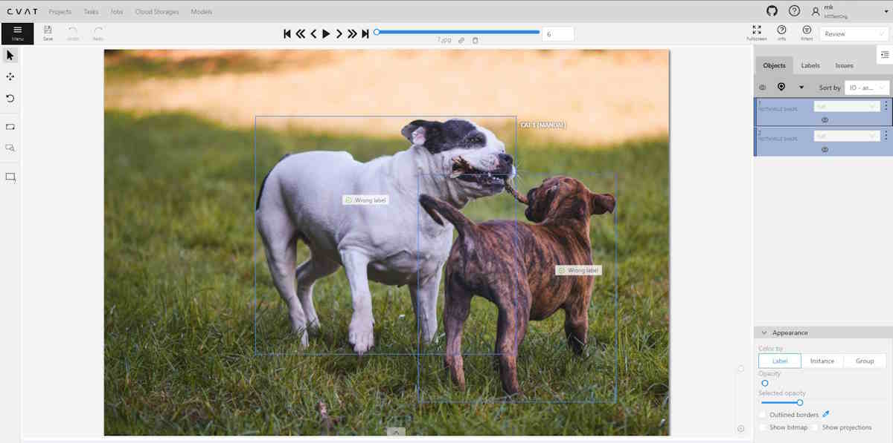
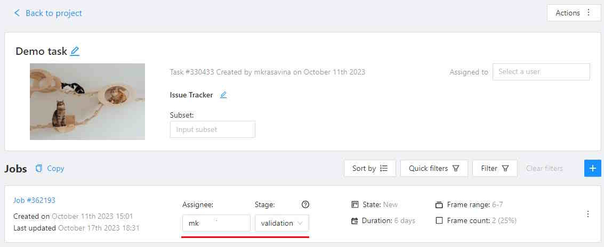
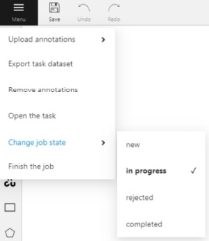
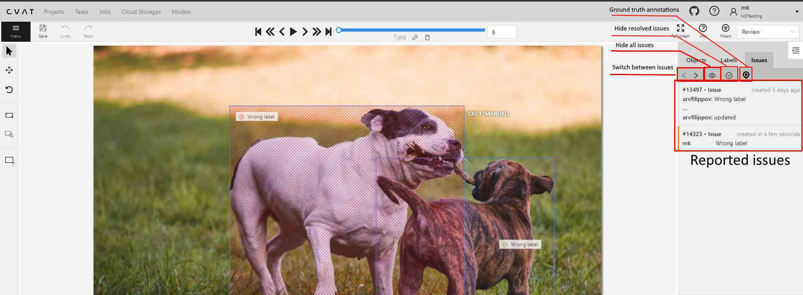
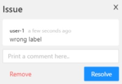

In the demanding process of annotation, ensuring accuracy is paramount.

CVAT introduces a specialized **Review mode**, designed to streamline the
validation of annotations by pinpointing errors or discrepancies in annotation.

{}
For 3D tasks, **Review mode** supports issue pins, optional object or track links,
and frame ranges in the point cloud.
See [Reviewing 3D tasks](#reviewing-3d-tasks).
{}

See:

- [Review and report issues: review only mode](#review-and-report-issues-review-only-mode)
  - [Assigning reviewer](#assigning-reviewer)
  - [Reporting issues](#reporting-issues)
  - [Quick issue](#quick-issue)
  - [Assigning corrector](#assigning-corrector)
  - [Correcting reported issues](#correcting-reported-issues)
- [Review and report issues: review and correct mode](#review-and-report-issues-review-and-correct-mode)
- [Issues navigation and interface](#issues-navigation-and-interface)
  - [Issues tab](#issues-tab)
  - [Issues workspace](#issues-workspace)
  - [Issues comments](#issues-comments)
- [Manual QA complete video tutorial](#manual-qa-complete-video-tutorial)

## Review and report issues: review only mode

Review mode is a user interface (UI) setting where a specialized
**Issue** tool is available. This tool allows you to identify
and describe issues with objects or areas within the frame.

{}
While in review mode, all other tools will be hidden.
{}

**Review** mode screen looks like the following:

### Assigning reviewer

{}
Reviewers can be assigned by project or task owner, assignee, and maintainer.
{}

To assign a reviewer to the job, do the following:

1. Log in to the Owner or Maintainer account.
2. (Optional) If the person you wish to assign as a reviewer
   is not a member of **Organization**, you
   need to .
3. Click on the **Assignee** field and select the reviewer.
4. From the **Stage** drop-down list, select **Validation**.

   

### Reporting issues

To report an issue, do the following:

1. Log in to the reviewer's account.
2. On the **Controls** sidebar, click **Open and issue** ().
3. Click on the area of the frame where the issue is occurring,
   and the **Issue report popup** will appear.

   

4. In the text field of the **Issue report popup**, enter the issue description.
5. Click **Submit**.

### Quick issue

The **Quick issue** function streamlines the review process.
It allows reviewers to efficiently select from a list of
previously created issues or add a new one,
facilitating a faster and more organized review.

To create a **Quick issue** do the following:

1. Right-click on the area of the frame where the issue is occurring.
2. From the popup menu select one of the following:

   - **Open an issue...**: to create new issue.
   - **Quick issue: incorrect position**: to report incorrect position of the label.
   - **Quick issue: incorrect attribute**: to report incorrect attribute of the label.
   - **Quick issue...**: to open the list of issues that were reported by you before.

### Assigning corrector

{}
Only project owners and maintainers can assign reviewers.
{}

To assign a corrector to the job, do the following:

1. Log in to the Owner or Maintainer account.
2. (Optional) If the person you wish to assign as a corrector
   is not a member of **Organization**, you
   need to .
3. Click on the **Assignee** field and select the reviewer.
4. From the **Stage** drop-down list, select **Annotation**.

   

### Correcting reported issues

To correct the reported issue, do the following:

1. Log in to the corrector account.
2. Go to the reviewed job and open it.
3. Click on the issue report, to see details of
   what needs to be corrected.

   

4. Correct annotation.
5. Add a comment to the issue report and click **Resolve**.

   

6. After all issues are fixed save work, go to the **Menu** select the **Change the job state** and
   change state to **Complete**.

   

## Review and report issues: review and correct mode

The person, assigned as [assigned as reviewer](#assigning-reviewer)
can switch to correction mode and correct all annotation issues.

To correct annotation issues as a reviewer, do the following:

1. Log in to the reviewer account.
2. Go to the assigned job and open it.
3. In the top right corner, from the drop-down list,
   select **Standard**.

   

## Issues navigation and interface

This section describes navigation, interface and
comments section.

### Issues tab

The created issue will appear on the **Objects** sidebar, in the **Issues** tab.

It has has the following elements:

| Element              | Description                                          |
| -------------------- | ---------------------------------------------------- |
| Arrows               | You can switch between issues by clicking on arrows  |
| Hide all issues      | Click on the eye icon to hide all issues             |
| Hide resolved issues | Click on the check mark to hide only resolved issues |
| Ground truth         | Show ground truth annotations and objects            |

### Issues workspace

In the workspace, you can click on the issue, and add a
comment on the issue, remove (**Remove**) it, or resolve (**Resolve**) it.

To reopen the resolved issue, click **Reopen**.

You can easily access multiple issues created in one
location by hovering over an issue and scrolling the mouse wheel.

### Issues comments

You can add as many comments as needed to the issue.

In the Objects toolbar, only the first and last comments will be displayed

You can copy and paste comments text.

## Reviewing 3D tasks

1. Open a 3D job and select **Review** in the workspace selector.
2. To report a location, click **Open an issue** in the left toolbar (or press
   **N**), then click a cuboid surface or a visible point-cloud point in **Top**,
   **Side**, or **Front**. This tool creates an unlinked issue point, even when you
   click a cuboid. It cannot place points in **Perspective**. You can still rotate
   the perspective scene while the tool is active. Dragging and clicking empty
   background do not place an issue.
3. To report an annotation, right-click the cuboid directly in any 3D view and
   select **Open an issue ...** or a quick issue. The issue is linked to that
   cuboid's shape or track and placed at its center. A previously selected object
   does not determine the target. Right-clicking empty space does not open an
   object issue menu. Unsaved linked annotations are saved when the issue is submitted.
4. Enter a description and click **Submit**. There is no object selector or frame
   range to configure. Every new issue applies only to the current frame, including
   issues linked to tracks. Its marker appears at the same XYZ location in the
   perspective, top, side, and front views on that frame.
5. Click an issue label to open its discussion on the perspective canvas or in
   an expanded 3D view. You can add comments, resolve the issue, or reopen it.
   Hover over an item in the **Issues** tab to highlight its location; click it to
   focus the issue. Opening a linked issue selects its cuboid in all four views
   when it is available and visible on the current frame. **Select** in the
   discussion selects and focuses the linked annotation.
   Cuboids with unresolved linked issues have a translucent red highlight.
   Hovering over an issue in the sidebar turns its cuboid's highlight yellow.
   The fill uses one color and keeps the point cloud visible.
   Resolving the last open issue removes the highlight;
   hovering over a resolved issue's label temporarily shows it again. The issue
   visibility controls also apply to this highlight. Unlinked issue points do not
   highlight annotations.
6. New 3D issues save the perspective camera view when they are created,
   including quick issues. Click **Restore review view** in the discussion to
   restore that camera position, viewing angle, and zoom. Moving the marker does
   not replace the saved view. Older issues without a saved view do not show this button.
7. Use the **Issues** tab arrows to jump to previous or next frames containing
   issues. The visibility buttons hide all pins or hide resolved issues.
8. Drag an issue's point marker or label in **Top**, **Side**, or **Front** to
   reposition it along the view plane, keeping its depth in that view. All views
   update together. Release to save the position, or press **Escape** to cancel.
   You can also adjust a new marker before submitting its description. Moving a
   marker does not move the annotation or change its object link.

An expanded pane shows only its own issue markers and discussion. Expanding a
camera image hides the 3D issue overlays. Unfinished comments and issue descriptions
are retained when expanding and restoring views.

Alongside incorrect position and attribute, 3D quick issues offer
**incorrect rotation** and **incorrect dimensions**. Tracks also offer
**incorrect track identity**. If the cuboid's label has attributes, use
**Quick issue: specific attribute** to include an attribute's name in the first
comment, for example, `Wrong attribute: visibility`. These presets use the same
comments, resolve, and reopen workflow as other issues; add a comment to explain
the expected correction.

Pins keep their XYZ location when annotations are edited. If a linked annotation
is deleted, its discussion and marker remain available. Switch to **Standard 3D**
to edit annotations; existing issues and comments remain available there.

## Manual QA complete video tutorial

This video demonstrates the process:

<iframe width="560" height="315" src="https://www.youtube.com/embed/7HxCpjdQt-c?si=xIho-KJLv4b__tRo" title="YouTube video player" frameborder="0" allow="accelerometer; autoplay; clipboard-write; encrypted-media; gyroscope; picture-in-picture; web-share" allowfullscreen></iframe>
