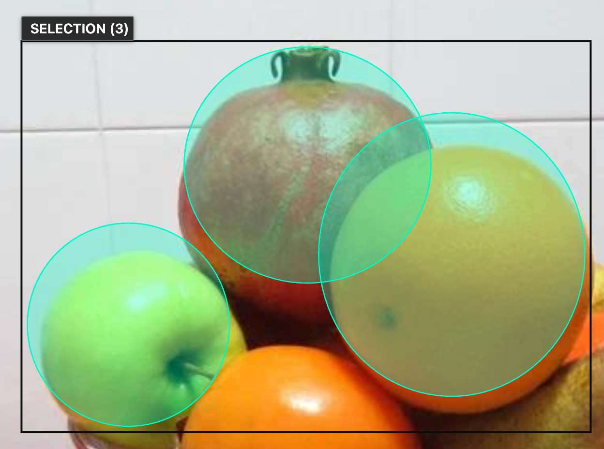

This release makes everyday annotation smoother, especially when your job contains many objects.

## Work more smoothly with large jobs

The annotation workspace performs better in jobs with many objects. We also improved
brush performance when working with larger segments.

## Predictable selection shortcuts

Multi-selection now uses fixed **Shift-drag** and **Ctrl/Cmd-click** gestures.
This removes false shortcut conflict warnings and makes the selection controls consistent.

The short recording below demonstrates selecting objects on the canvas.

<video controls preload="none" poster="./images/multi-selection.png" aria-label="Selecting multiple objects on the canvas">
  <source src="./videos/multi-selection.mp4" type="video/mp4">
  Your browser does not support embedded video.
</video>

## More reliable annotation tools

- Copying and pasting skeleton tracks with attributes now preserves keypoint attribute values.
- Keyboard shortcuts work correctly when copying selected text or editing text fields.
- Model loading waits for organization initialization, keeping the selected organization consistent between pages.

This release also includes security fixes. See the
[complete 2.79.0 release notes](https://github.com/cvat-ai/cvat/releases/tag/v2.79.0)
for the full list of changes.
